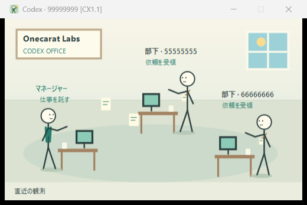

# Onecarat Agent Office CX

English | [日本語](README.md)

**Watch Codex at work in a small, animated office.**

A compact Windows app with stick figures that move in response to Codex activity. The main agent appears as the manager, and observed subagents appear as team members. Continue giving instructions and handling approvals in Codex itself.



*Screenshot of the actual app displaying synthetic test data for a delegation scene. This is not a record of activity from a real session. The screenshot shows the Japanese interface; the app also supports English.*

- **Already installed?** → [Everyday use](#everyday-use)
- **First time here, or just downloaded the repository?** → [Initial setup](#initial-setup)
- **No window or no movement?** → [Troubleshooting](#troubleshooting)

## Everyday use

### 1. Open the Codex session you want to watch

Office reads Codex session logs stored on the same PC. Open Codex first. You do not need to create another Codex session just to launch Office.

### 2. Ask that session to open Office

With this project open in Codex, ask:

> Open Onecarat Agent Office CX for this session.

The project's launch instructions identify the calling session and launch the protected installation. However, **the Codex environment may be unable to access the installation, or the window may appear on a different desktop. If that happens, use the PowerShell method below.**

No dedicated slash command registration is required. The Skill in this repository is not guaranteed to be available automatically in other projects.

### Launching from PowerShell

Open a regular Windows PowerShell window. Administrator privileges are not required. **Use the launcher below with a session ID instead of double-clicking the EXE.**

First, ask the target Codex session:

> Check this session's CODEX_THREAD_ID and give me the command to launch Office from regular PowerShell. Do not infer the ID from the newest log.

After verifying the ID, replace `PASTE-VERIFIED-THREAD-ID-HERE` below and run:

```powershell
$officeThread = 'PASTE-VERIFIED-THREAD-ID-HERE'
& "$env:LOCALAPPDATA\Programs\OnecaratCX\runtime\node.exe" "$env:LOCALAPPDATA\Programs\OnecaratCX\scripts\launch-office.mjs" --thread $officeThread
```

You can run this command from any working directory. If the ID cannot be obtained, stop rather than substituting another conversation's ID or choosing the newest log. The launcher also checks that the ID matches the actual session log.

### 3. Give Codex work as usual

Leave the window open and ask Codex to research, edit files, or perform other tasks. Characters move in response to activities the viewer can observe.

- Each session has its own window. Launching the same ID again reuses its existing window.
- To watch another session, ask that session to open Office or launch it with that session's ID.
- Closing Office does not stop Codex.
- You can move, resize, and minimize the window. Its initial size is 504 × 308.
- Right-click to toggle always-on-top mode or pause the animation.
- The app chooses its language at startup from the Windows display language: Japanese for Japanese, English otherwise.

## Understanding the display

| Display | Meaning |
|---|---|
| Manager on the left | The Codex session assigned to this window |
| Team members on the right | Subagents detected in real logs; two seats are available |
| Passing a document | The start of delegation to a subagent was observed |
| Thinking, researching, editing, or running commands | Activity observed in the logs |
| Turn ended | The current response or unit of work ended; the Codex session itself has not necessarily ended |
| Unknown state / last record | Current activity cannot be confirmed; the last observation is shown separately |
| Waiting for approval | An approval request was observed. Approve or reject it in Codex itself |

Seven seconds after a team member's turn is observed to end, its character is collapsed into the record at the bottom. Team members beyond the available seats are counted in the footer. Silence alone does not count as completion, and the viewer does not invent subagents.

**Approval waits cannot always be displayed reliably.** In the investigated Codex version, 0.169.0, approval requests were not persisted in session logs. Check Codex itself rather than relying solely on Office for approval notifications. Ordinary activity becomes unknown after 15 seconds without updates. An observed approval request is not cleared solely because time has passed.

## Initial setup

You need Windows 10/11, .NET Framework 4.8, Node.js 24 or later, and Codex configured to save session logs on the same PC.

**This repository contains source code. Downloading it from GitHub does not provide a ready-to-run EXE.** Build the app and install a protected copy for your normal Windows account. If it is already installed, skip this section.

### 1. Build and prepare the installation package

This example assumes the source is at `C:\work\onecarat-agent-office-cx`. Change the first path if needed. Run each command separately and stop if any command fails. No additional npm packages need to be installed.

```powershell
Set-Location C:\work\onecarat-agent-office-cx
npm.cmd run build
node scripts/package-office.mjs
powershell -NoProfile -ExecutionPolicy Bypass -File scripts/install-office.ps1 -ValidateOnly
```

The message `Package contents and hashes verified` confirms the package file and hash checks. This is not a software signature or a guarantee of overall safety.

### 2. Review and install the protected copy

Review the [security response and manual installation instructions (Japanese)](docs/SECURITY_RESPONSE_2026_11_22.md#レビューと手動配置), the script, and the package contents. Then **run the following yourself in regular PowerShell**:

```powershell
powershell -NoProfile -ExecutionPolicy Bypass -File scripts/install-office.ps1 -ReviewedPackage
icacls "$env:LOCALAPPDATA\Programs\OnecaratCX" /T
```

The installer expects Node.js at `C:\Program Files\nodejs\node.exe` by default. If it is installed elsewhere, append `-NodeExe 'ABSOLUTE-PATH-TO-TRUSTED-node.exe'` to the installation command.

The destination is `%LOCALAPPDATA%\Programs\OnecaratCX`. Check for `Installed reviewed copy with private ACL` and confirm that access permissions allow only your account, SYSTEM, and Administrators. Installation does not automatically launch Office or Codex. Once complete, proceed to [Everyday use](#everyday-use).

**If the destination already exists, installation stops without overwriting it.** There is no automatic updater. Review changes and the installation procedure separately when updating. Do not use the development-folder EXE as a substitute for the protected installation or loosen its access permissions.

## Troubleshooting

| Symptom | What to check |
|---|---|
| `-NoProfile` is not recognized | Include `powershell` at the beginning of the command |
| A launch command file cannot be found | Check that initial setup has been completed |
| `NO_THREAD` | Pass the target session's verified ID with `--thread` |
| `NO_LOG` or `LOG_UNAVAILABLE` | Check that the target session's logs are saved and readable on this PC. If you use a custom `CODEX_HOME`, the launcher must reference the same location |
| Asking Codex to launch Office produces no visible window | Launch from regular PowerShell using the verified ID |
| `Development-folder launch is disabled` | Use the protected installation's launcher instead of `npm start` or the development launcher |
| No team members appear | They appear only when actual subagent activity and its parent relationship can be detected in the logs |
| The state becomes unknown | There have been no log updates. This does not establish that Codex stopped or failed |

## How the read-only viewer works

Node.js reads local Codex JSONL logs and passes activity categories to a Windows Forms window. Conversation text, file contents, and command text are not passed to the UI. Observation results are not saved. The product has no external network communication, prompt submission, or Codex execution controls.

Changes to the log format, environments with log saving disabled, and sessions on another PC are not covered. See the [technical specification (Japanese)](docs/TECHNICAL_SPECIFICATION.md) for details.

## For developers

These commands validate the source. They are not required for everyday use.

```powershell
npm.cmd test
npm.cmd run test:desktop
powershell -NoProfile -ExecutionPolicy Bypass -File scripts/test-security.ps1
npm.cmd run check
```

Build output goes to `dist/v1.1-secure`, and the installation package goes to `release/onecarat-cx-secure`. Neither directory is tracked by Git. Legacy code and investigation records are retained for historical context but are not included in the product package.

The [synthetic animation preview (Japanese)](docs/MOTION_PREVIEW.md) is a development tool. Its animations are distinct from observations of real Codex activity, and it is not included in the protected product installation.

Additional documentation is currently in Japanese:

- [Technical specification](docs/TECHNICAL_SPECIFICATION.md)
- [Security response and validation records](docs/SECURITY_RESPONSE_2026_11_22.md)
- [GitHub integration notes](docs/GITHUB_SETUP.md)
- [Design decisions](docs/DECISIONS.md)

## License and disclaimer

This software is provided under the [MIT License](LICENSE). You may use, modify, redistribute, and use it commercially, provided you retain the copyright and license notices.

**The software is provided as is, without warranty. Use it at your own discretion and risk.** Its operation, display accuracy, and fitness for a particular purpose are not guaranteed. To the extent permitted by applicable law, the authors and copyright holders are not liable for claims, damages, or other liability arising from the software or its use.

This is a summary; see [LICENSE](LICENSE) for the full terms. Third-party software, including Node.js, is subject to its own licenses.
