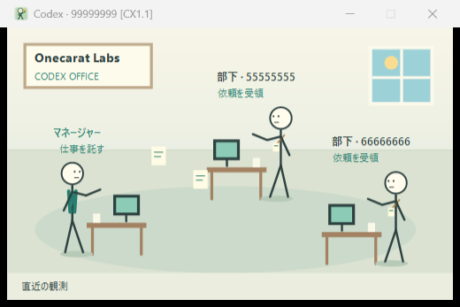

# Onecarat Agent Office CX

[English](README.en.md) | 日本語

**Codexが働く姿を、小さなオフィスで楽しく眺める。**

Codexの活動に合わせて棒人間が動く、Windows用の小窓アプリです。メインエージェントを「マネージャー」、実際に動いたサブエージェントを「部下」として表示します。Codexへの作業依頼や承認は、これまでどおりCodex本体で行います。



*画面例：実アプリに表示テスト用データを読み込ませて撮影した、委任の場面です。実際のセッションの活動記録ではありません。*

- **すでにインストール済み** → [普段の起動方法](#普段の起動方法)
- **初めて使う・GitHubから取得したばかり** → [初回セットアップ](#初回セットアップ)
- **小窓が出ない・動かない** → [困ったとき](#困ったとき)

## 普段の起動方法

### 1. 見たいCodexセッションを開く

Officeは、同じPCに保存されたCodexのセッションログを読み取ります。先にCodexを開いてください。Officeを起動するために、別のCodexセッションを新規作成する必要はありません。

### 2. そのセッションでOfficeの起動を頼む

このプロジェクトを開いたCodexに、次のように依頼します。

> このセッションのOnecarat Agent Office CXを起動して

プロジェクトの起動手順が、呼び出し元セッションを確認して保護済みのアプリを起動します。ただし、**Codexの実行環境からインストール先にアクセスできない場合や、窓が別のデスクトップに開く場合があります。その場合は、次のPowerShellによる起動を使ってください。**

専用スラッシュコマンドの登録は不要です。このリポジトリのSkillが、他のプロジェクトでも自動で使えるとは限りません。

### PowerShellから起動する場合

Windowsで通常のPowerShellを開きます。管理者として起動する必要はありません。**EXEのダブルクリックではなく、セッションを指定して次のランチャーを使います。**

まず、対象のCodexに次のように依頼してください。

> このセッションのCODEX_THREAD_IDを確認し、Officeを通常のPowerShellから起動するコマンドを教えて。最新ログからは推測しないで。

IDを確認できたら、次の `ここに確認済みのThread-IDを貼る` をそのIDに置き換えて実行します。

```powershell
$officeThread = 'ここに確認済みのThread-IDを貼る'
& "$env:LOCALAPPDATA\Programs\OnecaratCX\runtime\node.exe" "$env:LOCALAPPDATA\Programs\OnecaratCX\scripts\launch-office.mjs" --thread $officeThread
```

このコマンドは、どの作業フォルダからでも実行できます。IDが取得できない場合は起動を止め、別の会話のIDや一番新しいログで代用しないでください。ランチャーもIDと実ログの一致を検証します。

### 3. Codexにいつもどおり仕事を頼む

小窓を開いたまま、Codexで調査や編集などを依頼してください。観測できた活動に応じてキャラクターが動きます。

- 1セッションにつき1窓です。同じIDで再度起動すると既存の窓を再利用します。
- 別セッションも見たいときは、そのセッションで起動を依頼するか、そのIDで起動します。
- 小窓を閉じてもCodexの作業は続きます。
- ウィンドウは移動・サイズ変更・最小化できます。初期サイズは504×308です。
- 右クリックで最前面表示・アニメーション停止を切り替えます。
- 表示言語は起動時のWindows表示言語から自動選択します。日本語以外は英語です。

## 画面の見方

| 表示 | 意味 |
|---|---|
| 左のマネージャー | この窓に紐づくCodexセッション |
| 右の部下 | 実ログから検出したサブエージェント。表示席は2席 |
| 書類を渡す動き | サブエージェントへの委任開始を観測 |
| 思考・調査・編集・コマンド実行の動き | ログから観測できた活動 |
| ターン終了 | その応答・作業の区切り。Codexセッション自体の終了ではありません |
| 状態不明・最終記録 | 現在の活動を確定できない状態。最後に観測した情報と区別して表示 |
| 承認待ち | 承認要求を観測できた場合の表示。承認・拒否はCodex本体で行います |

終了を観測した部下のターンは、7秒後に人物を畳んで下部の記録へまとめます。表示席に収まらない人数は「表示外の部下 N」として表示します。記録が途切れただけで、終了した部下を作ったり架空の部下を登場させたりはしません。

**承認待ちは確実に表示できるとは限りません。** 調査したCodex 0.169.0では承認要求が保存ログに残らないため、Officeだけを承認通知として使わず、Codex本体も確認してください。通常の活動は15秒更新がないと現在状態不明になります。観測済みの承認要求は、時間経過だけで解除しません。

## 初回セットアップ

必要な環境はWindows 10/11、.NET Framework 4.8、Node.js 24以上、および同じPCにセッションログを保存するCodexです。

**このリポジトリはソースコードです。GitHubから取得しただけでは起動用EXEはありません。** ビルドして、普段使うWindowsユーザー専用の場所へ配置します。すでに配置済みなら、この節を繰り返す必要はありません。

### 1. ビルドと配置候補の作成

ソースを `C:\work\onecarat-agent-office-cx` に置いた例です。別の場所なら最初のパスを変更してください。以下は1行ずつ実行し、エラーになったら以後の操作を止めてください。追加のnpmパッケージのインストールは不要です。

```powershell
Set-Location C:\work\onecarat-agent-office-cx
npm.cmd run build
node scripts/package-office.mjs
powershell -NoProfile -ExecutionPolicy Bypass -File scripts/install-office.ps1 -ValidateOnly
```

最後に `Package contents and hashes verified` が表示されれば、配置候補のファイルとハッシュの確認は完了です。これはソフトウェアの署名や安全性全般の保証ではありません。

### 2. 内容を確認し、保護された場所に配置

[セキュリティ対応・手動配置手順](docs/SECURITY_RESPONSE_2026_11_22.md#レビューと手動配置)とスクリプト・配置候補の内容を確認してから、**通常のPowerShellで本人が**実行します。

```powershell
powershell -NoProfile -ExecutionPolicy Bypass -File scripts/install-office.ps1 -ReviewedPackage
icacls "$env:LOCALAPPDATA\Programs\OnecaratCX" /T
```

Node.jsの既定の参照先は `C:\Program Files\nodejs\node.exe` です。別の場所にインストールした場合は、インストールコマンドに `-NodeExe '信頼できるnode.exeの絶対パス'` を追加します。

配置先は `%LOCALAPPDATA%\Programs\OnecaratCX` です。`Installed reviewed copy with private ACL` が表示され、アクセス許可が本人・SYSTEM・Administratorsだけであることを確認してください。インストール処理はOfficeやCodexを自動起動しません。完了後は[普段の起動方法](#普段の起動方法)へ進みます。

**配置先がすでに存在する場合は上書きせず停止します。** 自動更新機能はありません。更新時は変更内容と配置手順を別途確認してください。開発フォルダのEXEを通常利用の代替として起動したり、保護先のアクセス権を緩めたりしないでください。

## 困ったとき

| 症状 | 確認すること |
|---|---|
| `-NoProfile` が認識されない | コマンド先頭の `powershell` も含めて実行してください |
| 起動コマンドのファイルが見つからない | 初回セットアップが完了しているか確認してください |
| `NO_THREAD` | 対象セッションの確認済みIDを `--thread` に指定してください |
| `NO_LOG`・`LOG_UNAVAILABLE` | 対象セッションのログが同じPCに保存され、読めるか確認してください。独自の `CODEX_HOME` を使う場合は起動側も同じ場所を参照する必要があります |
| Codexから起動を頼んでも窓が見えない | 通常のPowerShellから、確認済みIDを指定して起動してください |
| `Development-folder launch is disabled` | `npm start` や開発用ランチャーではなく、保護先のランチャーを使ってください |
| 部下が出ない | 実際のサブエージェント活動と親子関係がログから検出できた場合だけ登場します |
| 状態不明になる | ログの更新がない場合の表示です。停止や失敗を断定しているわけではありません |

## 読み取り専用の仕組み

Node.jsがローカルのCodex JSONLログを読み、活動の種類だけをWindows Formsの小窓へ渡します。会話本文・ファイル内容・コマンド本文をUIへ渡さず、観測結果を保存しません。製品に外部通信やCodexへの入力・実行制御機能はありません。

ログ形式の変更、ログ保存が無効な環境、別PCのセッションは保証対象外です。詳細は[技術仕様](docs/TECHNICAL_SPECIFICATION.md)を参照してください。

## 開発者向け

以下はソースの検証用です。通常利用のたびに実行する必要はありません。

```powershell
npm.cmd test
npm.cmd run test:desktop
powershell -NoProfile -ExecutionPolicy Bypass -File scripts/test-security.ps1
npm.cmd run check
```

ビルド出力は `dist/v1.1-secure`、配置候補は `release/onecarat-cx-secure` です。どちらもGitの追跡対象外です。旧コード・検証資料は経緯として保持しますが、製品の配置候補には含めません。

動きだけを確認する[合成プレビュー](docs/MOTION_PREVIEW.md)は開発用です。実際のCodex活動の観測結果とは区別し、保護済み製品には含めません。

- [技術仕様](docs/TECHNICAL_SPECIFICATION.md)
- [セキュリティ対応・検証記録](docs/SECURITY_RESPONSE_2026_11_22.md)
- [GitHub連携の作業記録](docs/GITHUB_SETUP.md)
- [設計判断の履歴](docs/DECISIONS.md)

## ライセンス・免責事項

本ソフトウェアは [MIT License](LICENSE) で提供します。著作権表示とライセンス文を保持することで、利用・改変・再配布・商用利用が可能です。

**本ソフトウェアは現状のまま、無保証で提供します。利用はご自身の判断と責任で行ってください。** 動作、表示の正確性、特定の目的への適合性などを保証するものではありません。適用法令で認められる範囲で、作者および著作権者は、本ソフトウェアの使用その他に起因する請求・損害・その他の責任を負いません。

この説明はライセンスの要約です。正式な条件は [LICENSE](LICENSE) を参照してください。Node.jsなどの第三者ソフトウェアには、それぞれのライセンスが適用されます。
