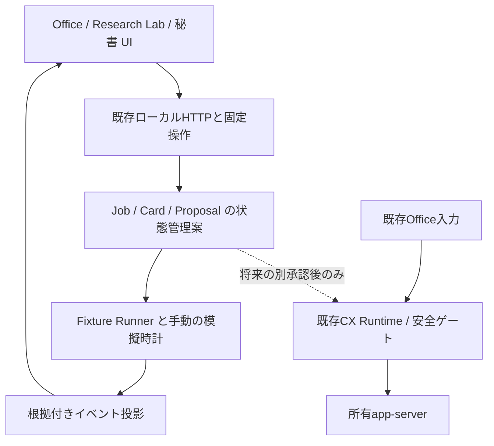

# フェーズ2詳細設計案

作成：2026-11-15。状態：**設計提案、未実装・未検証**。今回承認されたのは調査・設計・文書化のみ。フェーズ1は作者受入済みの条件付きPASSであり、完全PASSへ変更しない。

関連：[画面と操作](PHASE2_SCREENS.md)／[実装・テスト計画](PHASE2_PLAN.md)／[作者判断](PHASE2_OPEN_DECISIONS.md)。各文書内の具体構造・優先順位・状態名は、明示した既存要件を除き設計案である。

## 1. 根拠とスコープ

| 根拠 | 維持する事項 |
|---|---|
| [PRODUCT_SPEC](PRODUCT_SPEC.md)、DECISIONS D06〜D16 | Office・Research Lab・秘書を初回正式公開に含める。カード最大10件/テーマ/回、出典・担当・状態・不確実性、束、編集可能Skills、修正後の明示承認 |
| [ARCHITECTURE](ARCHITECTURE.md)、DECISIONS D17〜D19 | B主接続、A補助、C保留。管理外セッションの後付け観測を保証しない |
| [最終レビュー](PHASE1_ACCEPTANCE_REVIEW.md) | 77件/29項目は既存モックの結果。実E2Eは挨拶1回。R1〜R6が残る |
| [VALIDATION_PLAN](VALIDATION_PLAN.md) | 01〜09の接続・購読・resume制約を保持。thread/readは購読を意味せず、resumeは観測専用ではない |
| 現行src/runtime.mjs、state.mjs、server.mjs、ui/app.mjs | 所有stdio、固定HTTP API、世代境界、旧Thread隔離、明示接続、モデル既定無効。生RPCをUIへ公開しない |
| 今回の作者指示 | 設計のみ。認証/権限/安全ゲート変更、実送信、実Thread作成、無人実行、外部連携、公開、本実装は対象外 |

フェーズ2の機能境界自体は既存資料で確定していない。次の優先順位を推奨し、Q1の作者判断へ提示する。全体製品要件を縮小する決定ではない。

| 優先度 / 機能 | フェーズ2実装候補（将来承認後） | 今回外に残す機能・理由 |
|---|---|---|
| P0 共通業務状態 | Job/結果/提案の純粋な状態管理、モック環境の分離、旧データ隔離の表示 | 認証ゲート共通化R1、実認証変更検証は別承認 |
| P1 Office | 機能間ナビゲーション、活動と成果の導線、観測根拠、同梱キャラクター/背景の選択案 | A通信仲介・多クライアント共同操作、実サブエージェント起動 |
| P2 Research Lab | 複数テーマ、希望完了時刻、手動モック実行、カード/束/深掘り/レビュー、保存プレビュー | 実調査、外部URL取得、Google Drive、時刻による自動起動 |
| P3 秘書 | 架空の受信箱/カレンダー、Skills編集、対応提案、対話風の修正、最終内容確認のモック | 実メール取得/送信、実予定変更、OAuth、定期ポーリング |
| P4 ローカル保存 | 非機密UI設定、fixtureカード/提案のスナップショットと出力案 | 実成果本文の保存・復元はQ2と本人境界の判断まで保留 |

後続へ残す製品要件：指定時刻に向けた実調査、独立した定期実行、実サービス保存、実メール/予定の操作、サブエージェント分担・レビュー、PowerShell共同作業、配布・更新。モック実装でこれらを完成扱いしない。

## 2. 構成と既存機能への接続

実装候補は現行Node標準機能・ブラウザES modulesを継続する。フレームワーク移行や新依存を前提にしない。将来の配置案：`src/domain/`にデータ検証・reducer、`src/fixtures/`にモックrunner、`ui/views/`に3画面。既存Runtime/Rpcの全面改修は不要。

フェーズ2候補モードはmock専用の独立したローカルアプリインスタンスとする。Factoryはfixtureに固定し、Codex起動/任意RPC/外部fetchを実装しない。既存live UIの接続先を画面操作でmockと切り替える方式は採らない案。mock失敗時にliveへフォールバックしない。既存live Runtimeはそのまま保つ。画面上は「モック・外部送信なし」を常時示す。

将来live接続を検討する際も、新機能からRuntime.create/submit/answerを直に無制限呼出ししない。現行境界を通す個別adapterの設計・検証・承認が必要。ドメインJob IDとCodex Thread IDは別物で、Job生成をThread生成に結び付けない。

## 3. データ契約案

全オブジェクトにschemaVersion、id、revision、createdAt、updatedAtを持たせる。時刻はUTCのISO文字列、表示時はtimeZoneを使用。IDは不透明な内部IDで、任意のファイルパスとして使わない。上限値はQ5の仮置きであり確定仕様ではない。

| 型 | 主なフィールド | 制約 |
|---|---|---|
| Context | mode=mock、workspaceId、contextEpoch | live認証の本人識別に転用しない。epochはプロセス開始/境界変更で更新 |
| Job | kind=research/secretary、topicId?、runId、status、targetAt?、timeZone?、attemptId、binding? | bindingは同じ境界の観測済みThread/Turnのみ。モックはlive IDを参照しない |
| Topic | title、question、desiredCompletionAt?、timeZone、archived | テーマ変更は次回runへ反映。実行開始時の入力はrunにスナップショット |
| ResearchRun | topicId、inputRevision、jobId、resultStatus、cardIds、reviewStatus | 1テーマ/1回の成果最大10件。0件は0件と表示し埋めない |
| Card | runId、title、summary、sources[]、assignee、uncertainty、reviewState、parentCardId?、bundleId? | 出典が不明なら明示。本文・URLは未信頼入力 |
| Source | label、url?、publishedAt?、observedAt?、verification=unverified/fixture | URLが存在することを出典の検証済みとしない。自動取得しない |
| Bundle | rootCardId、orderedCardIds | 深掘りは別runにし、元カードと関連。循環参照・別workspace混入を拒否 |
| Skill | name、description、instructions、revision、enabled、mode=mock | テキストのみ。ローカルスクリプト/MCP導入/権限付与として解釈しない |
| Proposal | kind=reply/calendarChange、sourceFixtureIds、skillRevision、draft、revision、status | 宛先/件名/本文、または予定ID/変更前後/時刻帯を型別保持 |
| Confirmation | proposalId、proposalRevision、contextEpoch、decision、status | Codex承認要求とは別型。編集した内容に古い確認を適用しない |
| Evidence | mode、jobId、attemptId、eventId、sequence?、threadId?、turnId?、itemId?、observedAt、kind | 認証情報・生の要求全文は含めない |

Jobの実行完了、成果の受領、成果の品質評価、利用者の採用を独立フィールドにする。`turn/completed`は成果の正しさやメール送信成功の根拠にならない。出典/担当の欠落を推測で埋めず、カードに「未確認」と表示する。最大10件を超える結果は黙って破棄せず、当該runを`invalidResult`にして件数のみ示し、採用カードは置き換えない。

## 4. 状態遷移と競合

| 現在 | 入力/根拠 | 次 | 注意 |
|---|---|---|---|
| draft | 有効な内容で利用者が準備 | ready | 時刻入力だけで実行しない |
| ready | 「モック実行」を明示クリック | running | 新attemptIdを確定してからfixtureへ依頼 |
| ready | 模擬時計が希望時刻を超過 | ready（期限超過表示） | queue/自動送信を生成しない |
| running | 同じattemptの要求待ちイベント | waitingDecision | 応答と完了を分ける |
| running/waitingDecision | 同じattemptの明示完了/失敗 | completed/failed | Item単位の完了だけでは遷移しない |
| running/waitingDecision | 送信済みで応答不明/接続境界喪失 | unknown | 再試行・自動再開なし。旧内容を画面から隔離 |
| draft/ready | 利用者が取消 | cancelled | 未送信であることを確認 |
| running | モック停止操作＋停止確認イベント | cancelled | 将来liveでは接続切断を取消完了としない |

再試行はモックでのみ新attemptを明示作成し、旧attemptは不変で残す。unknownから同じattemptの再実行を認めない。フェーズ2候補に実キュー/実schedulerはない。

Proposalは`draft → reviewReady → confirmed → simulatedComplete`。修正は新revisionを作り`draft`に戻す。取消は未送信だけ、疑似送信済みの結果不明は`unknown`。mockの確認はUIに「外部送信なし」と明示し、実メール等の実行許可に転用できない。Codex Approvalは既存のpending/checking/sent/answered/cancelled/unknownを保ち、Proposal Confirmationと共用しない。

操作は`operationId + expectedRevision + contextEpoch`を付ける提案。サーバーで対象・mode・epoch・revisionを照合し、重複operationIdは同じ内容なら既存結果を返し、副作用を再実行しない。異なる内容の同じID、古いrevision/epochは409相当で拒否。永続化失敗時は成功と応答せず、未知の結果を自動再試行しない。実サービスのexactly-onceを保証するものではない。

モックイベントは一意eventIdとattempt内sequenceを持ち、重複・古いattemptを無視。実Codexのdeltaに同じ保証があるとは扱わず、現行projectの完成Item優先を保持する。イベント本文のハッシュを安易にIDにせず、本文や秘密をログに出さない。

## 5. Office投影

各Jobに機能種別・テーマ/提案タイトル・状態・根拠・成果参照を持たせ、Officeから対象画面に移動できる。計画上の担当枠は「担当予定」と表示し、実在の作業中人物として描かない。モック人物にはfixture表示を付ける。将来の実サブエージェントは現行と同様に観測IDがあるものだけ。

テーマ件数・時計・アニメーションから作業開始/完了を推定しない。カード作成と人物の喜ぶ演出は成果受領イベントを根拠にするが、「内容検証済み」はレビュー結果の別表示とする。背景/人物の外観変更はローカル表示設定で、エージェント数/状態/権限を変えない。

## 6. 保存・認証境界・外部境界

推奨する初期範囲はfixtureの本文だけ保存可能、実会話/メール/成果本文は新たに保存しない（Q2）。非機密の外観設定は別保存。既存state.json、Codexホーム、検証マーカーを流用しない。候補保存先は`.cx/phase2-mock/`内の専用schemaファイル。書込みは一時ファイル→置換、旧schemaは自動上書きせず読取停止。新規実装時に破損/並行書込/再起動を試験する。

保存fixtureはmode=mockを必須とし、ロード時に常にMOCKとして扱う。再起動でrunningだったJobはunknownとなり再開しない。liveの旧Threadや成果は本人の安定識別がないため自動ロード・再帰属しない。境界変更時は新機能のメモリ、下書き、結果、確認内容も消去し、遅延応答を捨てる必要がある。この設計は本人識別の解決ではない。

ローカル保存体験はまず内容プレビュー/fixture限定出力案まで。実フォルダ選択・実成果本文出力の採用はQ2へ。Google Drive/Gmail/iCloudは接続ボタンを有効化せず、未接続の説明のみ。URLの自動プレビュー、外部画像、追跡リンク、HTML実行、任意パス読込を行わない。Skills本文に外部操作指示があってもモックrunnerの能力は増えない。

## 7. 提案HTTP契約（未実装、Codex公式APIではない）

既存Host/Origin/Cookie/固定API境界を維持。任意メソッド転送の入口は増やさない。

| 操作案 | 入力の要点 | 出力/失敗 |
|---|---|---|
| GET phase2/state | 認証済みの同一local origin | mode、contextEpoch、revision、許可されたfixture状態 |
| POST phase2/topic/save | operationId、expectedRevision、title/question/targetAt/timeZone | Topicまたは入力エラー。自動実行なし |
| POST phase2/research/simulate | topicId、inputRevision | Job/run ID。mockプロセス限定、liveでは未対応 |
| POST phase2/card/organize | cardId、親/束/並び順、revision | 循環/不存在/別contextを拒否 |
| POST phase2/research/deepen | 元cardId、追加の質問 | 新規fixture runと元カード関連。最大10件はそのrunにも適用 |
| POST phase2/skill/save | instructions等のテキストとrevision | テキスト検証のみ、コード実行なし |
| POST phase2/proposal/edit | proposalId、変更内容、revision | 新revision、旧確認は失効 |
| POST phase2/proposal/confirm | proposalId、表示済みrevision、decision | モック確認だけ。未表示/旧版/二重を拒否 |
| POST phase2/export/preview | card/bundle/proposalのID | 安全なfixture文書のプレビュー。任意パスやURLを受け取らない |

具体URLはCX内部の設計案。実装時は未対応操作を成功風に返さず、`MOCK_ONLY`、`STALE_REVISION`、`INVALID_RESULT`、`RESULT_UNKNOWN`など内容を含まない固定エラーへ分類する。ライブ状態や認証ゲートを書き換えるAPIは追加しない。

## 8. フェーズ1残課題の影響

| 残課題 | フェーズ2への影響 / 維持条件 |
|---|---|
| R1 接続先チェック差 | モック設計は可能。通常live運用への移植は別承認・共通化検証まで不可 |
| R2 本人/workspace一致未保証 | 実成果の復元/共有/再開を設計済みとはしない。fixture領域を分離し旧実データ非表示 |
| R3 実承認/通信断/委任未実証 | モックで状態契約を試す。実業務や無人ジョブへ昇格しない |
| R4 規約/公開/サービス条件 | 今回は採用・法的適合の新判断なし。外部連携・公開の段階で再調査 |
| R5 保存/外観/A連携 | 外観とfixture保存は候補。A・履歴復元・実成果保持を完成条件から分離する提案 |
| R6 負荷/障害/アクセシビリティ | フェーズ2モックで負荷・保存異常・キーボード検証を追加。Windows実強制終了等とは別記 |
