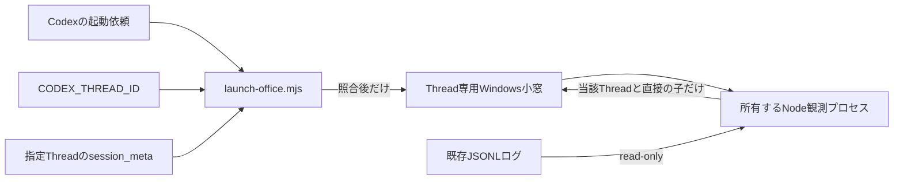

# Onecarat Agent Office CX v1.1 詳細技術仕様書

## セキュリティ改訂（2026-11-22、以下の旧記載に優先）

現行開発ビルドはdist/v1.1-secure、手動配置候補はrelease/onecarat-cx-secure。通常起動は本人専用ACLのLocalAppData/Programs/OnecaratCXコピーを使う。実配置とACL変更は未実施。開発ランチャーの通常起動は拒否し、明示的な開発検証か読取専用--checkだけを許可する。Skill/AGENTS/READMEも保護先を案内する。

ランチャーとworkerの環境を許可リストへ変更。Nodeは保護先runtime/node.exe優先、指定パスはローカル絶対パス・node.exeという名前・存在を検査。未指定時はPATHの絶対ディレクトリを走査し、アプリ直下とカレントを除外する。モデルの対応表はObject.hasOwnと文字列型で制限し、UIでも列挙値を制限。openLogは読取ハンドルのfstat、前後lstat、realpathを検査する。ビルドはobserverの7モジュールを含む。旧版の環境継承・起動手順の記載は履歴として扱う。詳細は[セキュリティ対応](SECURITY_RESPONSE_2026_11_22.md)。

| 項目 | 内容 |
|---|---|
| 文書版 | 1.1 |
| 更新日 | 2026-11-21 |
| 根拠 | 作者の「v1.1 改修指示書」、現行ソース、保存した検証結果 |
| 対象 | セッションに明示的に紐付くWindows観測専用小窓 |
| 実行物 | `dist/v1.1-small/Onecarat-CX.exe` |
| 旧版 | [v1.0技術仕様](TECHNICAL_SPECIFICATION_V1_0.md)に保存 |

## 1. 製品範囲

2026-11-22の高さ調整：標準504×308、論理ステージ620×378。人物・机・役割・委任演出を16論理px上へ移動し、人物サイズは維持。下部は状態＋部下の記録の1行とし、Thread IDはタイトルに残す。製品はdist/v1.1-smallへ出力する。証拠画像はartifacts/visual-review/compact。

### 追補：マネージャーと部下の演出

作者の追加依頼により、親は左の緑のベスト・ネクタイと「マネージャー / Manager」、子は右の名札と「部下 / Agent」で区別する。子の身体・顔・腕・机を左右反転し、文字は反転せず描く。標準クライアントサイズは520×340。稼働中の旧EXEを上書きしないため、更新版をdist/v1.1-smallへ出力し、ランチャーも同版を参照する。

SubAgentActivityのstartedだけを委任の根拠としてassignedAtへ記録し、子の新しいログ状態を併合しても保持する。interactedは指示内容を確定できないため新しい委任演出の根拠にしない。assignedAtから6秒未満、監視正常、子が明示完了していない間に手を差し出し、書類を親から子へ移動させる。古い開始・親IDのみ・一般的なツール呼出しから委任を捏造しない。アニメーション停止時は書類を中間位置に固定する。表現は実際の物理的な書類ではなく委任記録の視覚化である。

表示順は親を先頭固定し、委任直後の子、鮮度のある活動中の子、それ以外の順。同順位は最新観測順。古い子を終了扱いに変更することなく、限られた枠で新しい子を優先する。明示完了後の退場条件は従来通り。

管理操作を行わず、ログに記録されたCodexの活動を人物の動きで可視化する。1つの呼び出し元Threadに専用窓を1つ割り当てる。別のCodexセッションを新規作成しない。起動指示のない既存セッションの窓を勝手に開かない。

本アプリはプロンプト、承認・拒否、実行・停止・resume、設定・認証変更をCodexへ送らない。Research Lab、秘書、ターミナル、スケジュール、外部通信は対象外。

## 2. v1.0からの変更

| v1.0 | v1.1 |
|---|---|
| 一覧から表示セッションを選択 | 起動時にThreadを固定し、1Thread1窓 |
| 最近のログを一覧表示 | 起動元IDと一致するログを必須とする |
| 上部のブランド・操作列 | ステージの壁面看板、操作は右クリックへ |
| 言語ボタンとCurrentUICulture | Windows表示言語API、切替ボタンなし |
| 承認も鮮度だけで不明 | 未解決要求を活動と別管理し、時間だけでは消さない |
| 子のsource情報だけ | source情報に加えSubAgentActivityを扱う |
| 子ログ内の親metaでIDが上書きされ得た | ファイル自身のidentityを固定し、継承履歴を分離 |

旧EXE・旧実装・既存プローブ・消費済みマーカーは履歴として保持し、v1.1の製品起動から除外する。

## 3. コンポーネントと実行環境

Windows Forms / GDI+（.NET Framework 4.8前提）とNode.js 24以上の標準機能で構成する。実機確認したNodeはv24.19.0、Codexのログは0.169.0。



| ファイル | 主な責務 |
|---|---|
| [desktop/V11.cs](../desktop/V11.cs) | 表示言語、窓のlease、UI、描画、Node所有・終了 |
| [observer/binding.mjs](../observer/binding.mjs) | Thread指定検査、観測先、ファイルとメタデータの照合 |
| [observer/main-v11.mjs](../observer/main-v11.mjs) | 観測ループ、Threadスコープへの絞り込み、pipe出力 |
| [observer/model-v11.mjs](../observer/model-v11.mjs) | identity、承認、子活動、セッション終了の追加状態 |
| [observer/model.mjs](../observer/model.mjs) | 基本の活動変換・Turn対応・fresh判定 |
| [observer/watcher.mjs](../observer/watcher.mjs) | 差分読取。v1.1用のfactory/projector/viewを注入 |
| [scripts/launch-office.mjs](../scripts/launch-office.mjs) | 呼出元の照合、言語付き案内、専用EXE起動 |
| [skills/office-cx/SKILL.md](../skills/office-cx/SKILL.md) | Codexからの起動手順と推測禁止条件 |

HTTP・WebSocket・WebView・外部サービスは使用しない。

## 4. 起動元セッションの特定

### 4.1 IDの選択

通常起動では、Codexのツールプロセスに継承された`CODEX_THREAD_ID`を使う。UUID形式を検査し、小文字へ正規化する。`--thread`が明示されている場合はその値を対象とする。

`CODEX_SESSION_ID`は使用しない。実機では子ログが親と同じsession_idを持ち、独立したidを持つことを確認した。ThreadとSessionを名前だけで同一視しない。

環境値は同一ユーザーのツール実行環境を信頼する境界であり、任意の別プログラムによる環境変数の偽装を暗号学的に検出するものではない。

### 4.2 ファイルとメタデータの照合

1. `CX_SESSIONS_DIR`、`CODEX_HOME/sessions`、既定ホームの`.codex/sessions`の順で観測先を決める。
2. 数字2～4桁のディレクトリを最大3階層探索する。上限10,000エントリー。
3. `rollout-`で始まり、指定UUIDと`.jsonl`で終わるファイルを探す。
4. 候補が0件ならNO_LOG、複数ならAMBIGUOUS_LOGとして拒否する。
5. realpathがルート内にあることを検査し、read-onlyで先頭最大512KiBを読む。
6. 最初の完全行がsession_metaで、payload.idが指定Threadと一致することを要求する。

最新更新時刻、cwdの一致、会話本文、タイトルから呼び出し元を推定しない。IDがない場合はNO_THREAD。不一致ならIDENTITY_MISMATCH。revert等でファイル名が別のrollout IDになっている配置は、現行の照合では起動できない場合がある。その場合も別ログへ推測で切り替えない。

### 4.3 起動導線

```powershell
node C:/work/onecarat-agent-office-cx/scripts/launch-office.mjs
```

`--check`では照合結果・Thread ID・表示言語をJSONで返し、窓を開かない。明示的な対象指定は`--thread <UUID>`。

このプロジェクトのAGENTS.mdが「Officeを起動して」という依頼をSkillファイルへ案内する。標準の`.agents/skills`配置は環境の書込制限により使用していない。Skillをグローバル登録した、またはスラッシュコマンドとして自動認識済みとは扱わない。別プロジェクトのCodexからも絶対パスのランチャーを実行可能だが、そのプロジェクトへ指示ファイルは追加していない。

### 4.4 EXE直接起動

EXEも`CODEX_THREAD_ID`または`--thread`を要求する。ID不在ではWindows表示言語に合わせた起動案内を出して終了する。Threadが指定されても、そのログの照合に失敗すれば観測プロセスはbinding-errorを返し、別Threadを表示しない。

通常のエクスプローラー起動には呼出元Codexの情報がない。自然言語からのランチャー起動を主経路とする。

## 5. 1セッション1ウィンドウ

### 5.1 重複防止

Windowsの名前付きMutexを使う。名前はWindowsユーザーSID、製品世代、Thread IDから構成する。

```text
Local\OnecaratCX11-<Windows SID>-<Thread ID>
```

最初のプロセスがmutexを保持する。重複起動は既存の名前付きEventWaitHandleへ再表示を通知して終了コード10で終了する。既存窓は最小化されていれば復元する。通常のアクティブ化を要求して入力フォーカスを奪う処理はしない。

再表示イベントは表示制御だけであり、Codexへ送る経路ではない。別ユーザー、別Windowsログオンセッションの窓を共有する設計ではない。閉じるとleaseを解放し、再度同Threadから起動できる。

### 5.2 配置

別の名前付きmutexでslotを0～31から確保する。初期サイズとプライマリモニターの作業領域から行数・列数を計算し、右上から下、次に左の列へ配置する。余白12px、窓間12px。画面に収まる配置数を超えた場合は18pxずつずらす。

32個を超える同時窓は拒否する。移動・サイズ変更後の既存窓の矩形を再配置する機能はないため、利用者の操作後や画面が小さい場合の非重複を保証しない。初期2窓の非重複は自動テストで確認した。

### 5.3 イベントの分離

観測プロセスは指定ThreadのファイルをpinnedPathとして保持する。root状態はそのファイルから取得し、別のファイルに含まれる同IDの継承履歴をrootの代わりに使わない。

出力するactorsはrootとその直接の子だけ。Windows側もスナップショットのthreadが自身のThread IDと一致することを要求し、他の親を持つactorを除去する。root不在、誤ったroot順序、解析失敗は不明表示にする。

## 6. 観測ループと読取制約

| 処理 | 設定 |
|---|---:|
| Nodeの次回tick | 処理完了から750ms後 |
| ファイル探索 | 前回から3秒以上 |
| rootの照合再確認 | 前回から5秒超 |
| 通常の活動fresh期限 | 記録時刻から15秒未満 |
| UI受信無応答期限 | 最終受信から5秒超 |
| UIタイマー | 50ms |
| 通常追跡候補 | 最大64ファイル、加えてpinned root |
| 候補の更新条件 | 直近24時間更新、または既に追跡中 |
| 読取chunk・最大行長 | 各512KiB |

1MiB超の初回読取は先頭の完全な1行と末尾512KiBを用い、途中履歴は復元しない。小さいファイルは512KiBずつ先頭から読む。未完成行はBufferで保持し、LF到達時にJSON化する。巨大行は改行まで捨てる。壊れた行を無視し、読み取り位置を進める。

ファイル縮小やino変更時には状態を初期化する。同じinoの同サイズ以上への書換え検知は保証しない。ログは追記型を前提とする。探索でのリンク除外とopen前のrealpath照合を行うが、悪意ある同一ユーザーによる置換競合を完全に排除する仕組みではない。

子の候補を発見するため他の最近のログを内部で読むことはあるが、その本文・活動を無関係な窓へ渡さない。完全にrootファイルだけを読む設計ではない。

## 7. identityと継承履歴

実際の子ログには、自分のsession_metaの後に親のsession_metaや親の履歴が含まれていた。v1.0では後続metaを適用して子が親IDになっていた。

v1.1では、ファイル名のIDに一致した最初のsession_metaを採用し、identityConfirmed=trueとする。以後のsession_metaでidentityを上書きしない。採用したヘッダーのtimestampをidentityAtとして保持し、それより古いイベントを採用しない。

```text
子自身のヘッダー → identity確定
コピーされた親のヘッダー → 無視
子作成前の親イベント → 無視
子作成後の子イベント → Thread/Turn条件を検査して採用
```

有効なthread_idが自分と異なる場合も無視する。identity未確定のまま活動を描かない。この修正は実ログで2つの子IDと親IDの対応を確認し、同形の合成回帰テストも追加した。

## 8. 活動状態

基本状態はid、parent、activity、at、turn、terminal、version、events。v1.1でrequests、approval、children、sessionEnded、identityConfirmed、identityAtを追加する。プロンプト、cwd、コマンド、ツール出力、変更内容を状態へコピーしない。

IDは英数字・アンダースコア・ハイフンの1～100文字に制限する。起動時のThread IDだけはUUID形式を要求する。

| 元記録 | 活動 |
|---|---|
| task_started | working |
| task_complete | finished（ターン終了） |
| turn_aborted | interrupted |
| reasoning / Reasoning Item | thinking |
| CommandExecution Item / exec_command_begin | running |
| FileChange Item / patch_apply_begin | editing |
| ImageView Item | reading |
| WebSearch Item | researching |
| assistant message / AgentMessage Item | reporting |
| 既知ツール名 | shell系=running、apply_patch=editing、read_file/list_dir=reading等 |
| その他の通常ツール名、execラッパー | tool |
| ツール出力の存在 | working。出力本文は使わない |

古い時刻や別Turnの終端を適用しない。終端済み同Turnの再開始や、その後のresponse_itemで終了状態を戻さない。すべてのイベントを重複排除するものではない。eventsは採用回数であり、進捗やユニーク処理数ではない。

15秒のfreshは、活動記録の新しさの補助であり、Codexが停止した証拠ではない。ItemCompletedからrunning等になっても、現在まだ実行中という保証ではなく直近の記録を示す。

## 9. サブエージェント

### 9.1 存在と親子関係

次のいずれかだけを根拠とする。

1. 子自身の`session_meta.payload.source.subagent.thread_spawn.parent_thread_id`。
2. 親の`item_completed.item.type == SubAgentActivity`に含まれる`agent_thread_id`とkind。

spawn_agentというツール呼出しだけで子を作らない。名前やプロンプト本文から推測しない。kindはstarted/interacted/interrupted/completedを扱う。

### 9.2 作業と報告

startedはarrived、interactedはworking、interruptedはinterrupted、completedはreportedへ変換する。子自身のログが存在すれば、記録時刻の新しい活動を優先する。子ログのtask_completeだけでは子の存在終了と判定しない。

completedの明示記録がある子だけ、報告・お辞儀・手振りから退場の演出を行う。これは作業完了が記録された子をステージから退場させる演出であり、OSプロセス終了の検知ではない。新しい活動が観測された場合は再び表示対象になる。

### 9.3 表示上限

rootと直接の子を1段に並べる。人数上限は`max(2, floor((clientWidth - 25) / 155))`。既定幅520では3人。収まらない人数は+N。孫の再帰表示は行わない。

## 10. 承認待ち

### 10.1 取得の実証と制約

実ログ7ファイルの構造調査では承認要求イベントを観測しなかった。さらにCodex 0.169.0の[rollout保存処理](https://raw.githubusercontent.com/openai/codex/rust-v0.169.0/codex-rs/rollout/src/policy.rs)でExecApprovalRequestとApplyPatchApprovalRequestは非永続イベントに分類されることを確認した。

したがって、現在のJSONL観測で実際の承認待ちを確実に取得できるとはしない。承認要求を発生させるために安全設定を変更したり、承認画面を操作する実験はしていない。

### 10.2 保持モデル

明示的なexec_approval_request/apply_patch_approval_requestを取得した場合、call_id、Turn ID、記録時刻だけをrequestsへ保持する。通常64件と上限超過の未解決要約1件まで。内容や判断理由は保持しない。

複数要求は別々に管理し、1件の解除で他の要求を消さない。ID不明の要求を適当なコマンドと対応付けない。

| 条件 | 公開状態 |
|---|---|
| 未解決要求なし | none |
| 未解決要求があり、最も古い要求が15秒未満 | pending |
| 要求が古い、またはUIの観測が不確か | uncertain |

pendingは「承認待ち・Codexで確認」、uncertainは「承認要求を観測・現在の解決状況は不明」と表示する。いずれも橙色の帯と枠、手を上げる姿勢を使う。15秒だけでnoneへ戻さない。

### 10.3 解除根拠

- 同じcall_idのコマンド開始・終了、patch開始・終了。
- 要求call_idと一致するItem IDの完了。
- 同じ既知Turnのtask_completeまたはturn_aborted。
- 異なる既知Turnのtask_started。
- 明示的なsession_end。

これらは当該要求で待っている状態ではなくなった根拠として扱うが、承認・拒否のどちらだったかは判定しない。別callの開始、応答本文、無関係な活動だけでは解除しない。

ログ欠落、ファイル再読込、アプリ再起動で要求を取り逃す可能性がある。承認キューとの完全な同期機能ではない。

## 11. ターンとセッションの寿命

task_completeはターン終了としてお辞儀・手振りを表示する。窓は維持する。最終ターン終了の記録は、その後の活動がない場合もフッターに残す。

session_endという明示イベントを入力するテスト経路ではsessionEnded=trueとし、セッション終了を表示する。このイベントが対象Codex版の実ログに保存されることは未確認。したがって、実運用でセッション終了を確実に検出できるとは案内しない。

窓の自動終了は採用しない。利用者が閉じるまで表示を維持する。ログが消えた、更新がない、Nodeが終了した、ターンが終わったという理由をセッション終了へ読み替えない。

## 12. Windows表示言語

`GetUserPreferredUILanguages(MUI_LANGUAGE_NAME)`で取得した順序付きUI言語リストの先頭を採用する。API説明は[Microsoft Learn](https://learn.microsoft.com/en-us/windows/win32/api/winnls/nf-winnls-getuserpreferreduilanguages)を参照した。

| 入力 | 判定 |
|---|---|
| ja、ja-*（大小文字を無視） | 日本語 |
| en、en-* | 英語 |
| その他 | 英語 |
| API失敗・空リスト・取得不能 | 英語 |

CurrentCulture、地域形式、タイムゾーン、キーボード配列を判定に使用しない。CurrentUICultureへの依存もなくした。製品に言語切替ボタンや--lang overrideはない。EXEの--languageは判定結果だけをstdoutへ出し、ランチャーが同じ言語で案内するために使う。

自動テストではja/ja-JP/en-US/de-DE/null、地域形式ar-SAとの独立性を確認した。日本語・英語の両画面はテスト専用コードで表示言語入力を注入して確認した。Windowsの表示言語設定自体を変更したわけではない。実APIは作者環境でjaを返した。

## 13. ステージとアニメーション

### 13.1 窓の仕様

| 項目 | 値 |
|---|---|
| 初期クライアントサイズ | 520×300 |
| 最小ウィンドウサイズ | 360×260 |
| 最大ウィンドウサイズ | 1000×700 |
| 最大化 | 無効 |
| 最小化・移動・サイズ変更 | 有効 |
| 最前面 | 初期true |
| 背景 | 淡い壁・床・窓・植物、昼夜の窓外配色 |
| ブランド | 壁の看板にOnecarat Labs / CODEX OFFICE |
| 操作 | 右クリックの最前面・動作切替のみ |

タイトルは`Codex · ID末尾 [CX1.1]`。承認関連の情報がある場合は接頭辞を付ける。通常の画面操作コントロールは0個。最小化中は描画を止めるが観測を続ける。

### 13.2 動作

| 状態・根拠 | 演出 |
|---|---|
| thinking | 顎に手、点の表示 |
| reading/researching | 資料を持つ |
| editing | ペンを動かす |
| running/tool/working等 | 机へ手を伸ばす入力風の動き |
| approval pending/uncertain | 手を上げ、橙色の帯・枠 |
| 子の初回表示 | 約1.5秒の短い歩行 |
| 明示的子completed | 報告、お辞儀、手振り、4～7秒で退場 |
| ターン終了 | 短いお辞儀、手振り。セッション窓は閉じない |
| freshでない | 基本は静止。承認履歴や終了の事実は別表示 |

高揚・成功祝い・ハイタッチを無根拠な成功判定に使わない。frameをUIタイマーで進める演出であり、実際の打鍵や進捗の再現ではない。システムのUIEffectsEnabledを動作の初期値に用い、右クリックで停止可能。

## 14. プロセス間JSON

NodeからWindowsへ1スナップショット1行で送る。以下は合成例。

```json
{
  "status": "watching",
  "thread": "11111111-1111-1111-1111-111111111111",
  "actors": [
    {
      "id": "11111111-1111-1111-1111-111111111111",
      "parent": "",
      "activity": "editing",
      "at": 1795262400000,
      "fresh": true,
      "version": "0.169.0",
      "events": 12,
      "approval": "none",
      "approvalAt": 0,
      "sessionEnded": false
    }
  ]
}
```

子にはendedが付く場合がある。これは明示的子作業完了の演出フラグで、OSプロセス生存を表さない。identityConfirmed、内部children、requests、turnは通常のactor出力へ渡さない。

Windowsは最新1行だけをpendingに保持し、131,072文字以上の行を受け入れない。中間スナップショットは上書きされ得る。Nodeはstdoutのdrainを待ち、無制限の出力キューを作らない。

## 15. 安全性と障害対応

生JSONLの読取とJSON解析では本文が一時的にメモリへ入る。UIへはID、親ID、固定活動種別、時刻等だけを渡す。本文を一切読まない方式ではない。IDもハッシュ化していないため完全匿名化とは言わない。

製品は認証ファイル・設定・SQLiteを開かず、観測結果や設定を保存しない。子環境からOPENAI_API_KEYとCODEX_API_KEYを除去するが、環境変数全体の秘密情報除去を保証する機能ではない。stderrの自由文は読み捨てる。

窓終了時は所有Nodeのstdinを閉じ、1,500ms待ち、必要ならそのプロセスだけKillする。既存CodexのPIDには触れない。親EOFとstdoutエラーでNodeも終了する。Nodeの自動再起動はない。

| 障害 | 挙動 |
|---|---|
| 指定IDなし・照合失敗 | 起動しない／binding-error。別ログへ切替えない |
| 個別読取エラー | partial、対象をunknown |
| root不在 | missing、ログ待ち案内 |
| Node終了・受信5秒超停止 | unavailable、観測を確認できない旨を表示 |
| 未解決承認があるときの通信障害 | 要求履歴を保持し、解決不明と表示 |
| UIへ別Threadのsnapshot | 拒否し、表示状態をクリア |

同一ユーザーの悪意ある実行物改変・レース・OS障害に対する完全な隔離や、負荷ゼロを保証するものではない。

## 16. ビルド・テスト

```powershell
npm.cmd run build
npm.cmd test
npm.cmd run test:desktop
npm.cmd run check
```

buildはdist/v1.1へC# EXEと5つのmjsを配置する。標準のC#コンパイラを使用し、外部パッケージをダウンロードしない。起動中の同EXEはWindowsにロックされるため、更新時はv1.1の小窓を閉じる。コピーとコンパイルは原子的更新ではない。

`test:desktop`はV11.csとV11Smoke.csを別entrypointでコンパイルし、合成ログから実Windowsフォームを操作する。テスト限定の言語指定・captureは製品entrypointに実装しない。

テスト用一時領域は`.cx/v11-tests`、成果物は`artifacts/v11`。全体テストには旧版のテストも含まれるため、その件数を実Codex成功件数として数えない。Pythonの実行可能環境が確認できなかったため、Skill標準validatorは未実行。作成した単純なfrontmatter、必須項目、名前・長さ・TODO残り、起動先とAGENTS導線をNodeテストで検証した。

## 17. 検証済み範囲と限界

詳細な結果・実行日時・成果物は[V1_1_REPORT](V1_1_REPORT.md)を参照。

- 呼び出し元CODEX_THREAD_IDと実ログidの一致を実機確認。
- ランチャーから実窓を起動し、2回目も同じウィンドウhandleを再利用したことを確認。
- 実ログから親＋過去に起動した子2つを識別し、活動snapshotを取得。
- 合成ログで別セッション2窓、混入拒否、重複防止、再開、日英、15秒超承認履歴、子報告・終了を確認。
- 実際の承認待ち検出、現在動く新しい子の誕生から退場までの一連のライブ確認は未実施。保存ポリシーと既存ログの確認、合成検証とは分ける。
- 実際のsession_end取得は未確認。自動閉鎖はしない。
- 高DPI、全Windows表示言語の実設定変更、複数モニター、長時間負荷・極端なログ数は十分に検証していない。

## 18. 根拠・改訂履歴

| 根拠 | 使用範囲 |
|---|---|
| 作者のv1.1改修指示書 | 製品範囲、1窓1セッション、途中確認不要の委任 |
| CC版src-tauri/src/router.rs、main.rs、README等 | 窓割当、再表示、終了の区別、表示言語方針の参考。コードコピーなし |
| [Codex Skill公式資料](https://learn.chatgpt.com/docs/build-skills) | Skillの形式と標準配置先の確認 |
| [Codex 0.169.0 rollout policy](https://raw.githubusercontent.com/openai/codex/rust-v0.169.0/codex-rs/rollout/src/policy.rs) | 承認イベントの非永続性 |
| [Codex protocol](https://raw.githubusercontent.com/openai/codex/rust-v0.169.0/codex-rs/protocol/src/protocol.rs) | 子の親ID・SubAgentActivityの型 |
| [Windows表示言語API](https://learn.microsoft.com/en-us/windows/win32/api/winnls/nf-winnls-getuserpreferreduilanguages) | 地域形式と独立した判定 |

2026-11-21：v1.1として全面更新。旧版は別ファイルへ保存。以後は実装と検証の変更に合わせて更新する。
