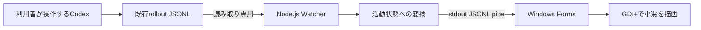
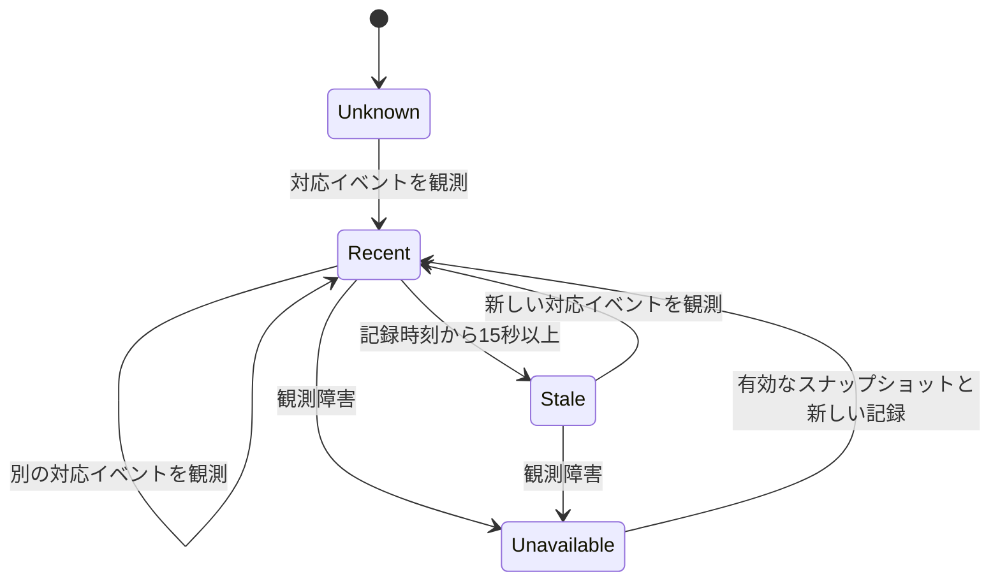

# Onecarat Agent Office CX 詳細技術仕様書

| 項目 | 内容 |
|---|---|
| 文書版 | 1.0 |
| 作成日 | 2026-11-21 |
| 対象 | Windows観測専用版の現行ソースコード |
| package.jsonの版 | 1.0.0、private |
| ブランド表記 | Onecarat Labs |
| 製品名 | Onecarat Agent Office CX |
| 作業ディレクトリ | `C:\work\onecarat-agent-office-cx` |
| 文書の性格 | 実装に基づく仕様。将来構想や未検証事項を分離して記載 |

## 1. 目的と適用範囲

### 1.1 製品目的

「Codexが働く姿を、小さなオフィスで楽しく眺める」を実現するWindowsアプリケーションである。利用者は通常のCodexを操作し、本アプリは既存のローカルセッションログを読み取り、記録された活動をキャラクターの姿勢・動き・短いラベルで表示する。

本アプリが示すものは**直近に記録された活動**であり、Codexの実行状態を保証するリアルタイム制御APIの応答ではない。ログ保存の遅延や欠落は表示にも影響する。

### 1.2 対象機能

- Windowsネイティブの小窓による可視化。
- セッションの発見、ログ追記の読み取り、活動種別の抽出。
- セッションごとの状態保持と表示対象の切り替え。
- 明示的な親子関係が取得できた場合の子キャラクター表示。
- 明示的な承認要求イベントが取得できた場合の強調表示。
- 日本語・英語、最前面切替、アニメーション停止・再開。
- 最小化、移動、サイズ変更、ウィンドウ終了に伴う観測プロセスの終了。

### 1.3 対象外

Codexへのプロンプト送信、承認・拒否、実行・中断・再開の制御、設定変更、認証変更、内蔵ターミナル、Research Lab、秘書、時刻指定実行、外部サービス連携、観測履歴の保存、進捗率・成功率の推定は実装しない。

旧CXの操作系コードは開発履歴として残るが、現在の実行物から参照しない。本書は旧フェーズ1/2の技術仕様を現行製品へ引き継ぐものではない。

### 1.4 証拠の区分

| 表記 | 意味 |
|---|---|
| 実装確認 | 現行ソースコードから確認した挙動 |
| 自動テスト | 合成データやテスト環境で確認した結果 |
| 保存済み実ログ確認 | 過去に保存された実ログの構造を確認した結果 |
| 実機継続観測 | 実際に動く開発セッションの追記を観測した結果 |
| 作者確認 | 本会話で作者から報告された事実 |
| 未検証 | コードの存在や他の成功だけでは実証されていない項目 |

## 2. 動作環境と実行物

### 2.1 想定環境

| 要素 | 仕様・確認範囲 |
|---|---|
| OS | Windows 10/11を対象。実機確認は作者のWindows環境 |
| Node.js | 24以上。検証時はv24.19.0 |
| デスクトップ基盤 | .NET Framework 4.8を前提とするWindows Forms / System.Drawing |
| C#コンパイラ | Windowsの`Microsoft.NET/Framework64/v4.0.30319/csc.exe` |
| Codex | 保存済み・継続観測を確認したログはCLI 0.169.0 |
| npm依存 | 製品実行時の追加パッケージなし |
| ネットワーク | 製品の通信処理・待受処理なし |

Windowsの全エディション・全DPI設定・全Codex版に対する互換性を検証したわけではない。Node.jsの版はpackage.jsonに指定するが、EXEから起動したNodeの版を実行時に厳密検査する機能はない。

### 2.2 配置

```text
dist/
  Onecarat-CX.exe
  Onecarat-CX-updated.exe     # ロゴ変更時に別名で作成した更新版
  observer/
    main.mjs
    model.mjs
    watcher.mjs
```

EXEは自身の配置先にある`observer/main.mjs`を読み込む。EXEだけを別フォルダへ移すと観測処理を起動できない。Node.js本体は同梱しない。

### 2.3 作成時点のビルド差分

2026-11-21のロゴ変更時、通常EXEが起動中で上書きできなかったため、`Onecarat-CX-updated.exe`を作成した。

| 対象 | 作成時点の内容 |
|---|---|
| `desktop/Office.cs` | 固定表記を`Onecarat Labs`へ変更済み |
| `dist/Onecarat-CX-updated.exe` | ロゴ変更を含めてコンパイル成功 |
| `dist/Onecarat-CX.exe` | ロゴ変更前にビルドした通常版 |
| `npm.cmd start` | 通常版の`Onecarat-CX.exe`を起動する |
| `npm.cmd run build` | 現行ソースから通常版を再生成する |

この差分は機能の別エディションではなく、実行中ファイルのロックに伴う一時的な成果物配置である。通常版を現行ソースへ揃える場合は小窓を閉じてからビルドする。本書の作成作業では再ビルドや起動中の小窓の終了を行っていない。

## 3. アーキテクチャ



Codexと本アプリの間にRPC・ソケット・操作用pipeは作らない。Codexが既に保存したファイルを読むだけなので、観測側が動かなくなってもCodexの実行制御には関与しない。ただしファイル読取によるCPU・ディスク負荷が完全にゼロという意味ではない。

### 3.1 モジュール責務

| ファイル | 責務 |
|---|---|
| [`observer/model.mjs`](../observer/model.mjs) | 許可したフィールドだけからセッション状態を更新。公開スナップショット生成 |
| [`observer/watcher.mjs`](../observer/watcher.mjs) | ログ探索、差分読取、行分割、破損・切詰めへの対応 |
| [`observer/main.mjs`](../observer/main.mjs) | 観測先決定、定期ループ、stdout出力、pipe終了対応 |
| [`desktop/Office.cs`](../desktop/Office.cs) | 子プロセス起動、スナップショット受信、選択管理、描画、終了処理 |
| [`scripts/start-desktop.mjs`](../scripts/start-desktop.mjs) | npm経由のEXE起動、使用中Nodeのパスを引き渡す |
| [`scripts/build-desktop.ps1`](../scripts/build-desktop.ps1) | 観測コードのコピー、C#コンパイル |
| [`desktop/Smoke.cs`](../desktop/Smoke.cs) | テスト専用フォーム操作ハーネス |

### 3.2 app-serverを使用しない理由

旧CXのapp-server操作系と、別途動く既存Codexセッションの受動観測は異なる。今回の実装では、既存Threadへの接続・復元・購読に伴う副作用を持ち込まず、既存ログを観測する方式を選んだ。

過去に行ったapp-serverの技術調査と今回の採用理由は[OBSERVER_DESIGN](OBSERVER_DESIGN.md)に記録している。本書作成時にapp-serverを起動して再検証したわけではない。

## 4. プロセスとライフサイクル

### 4.1 起動順序

1. Windows Formsが初期設定・コントロールを作成する。
2. `Shown`で観測用Nodeプロセスを1つ起動する。
3. Nodeは観測先を決定し、最初の`Watcher.tick()`を実行する。
4. Nodeはスナップショットを1行のJSONとしてstdoutへ出力する。
5. Windows側は最新の受信行を保管する。
6. 50ms周期のUIタイマーが受信行を反映し、描画を更新する。

1つのウィンドウにつき観測プロセス1つである。多重起動を禁止するmutexや単一起動制御はなく、EXEを複数起動するとそれぞれ観測する。

### 4.2 観測プロセスの起動条件

- 実行ファイルは`CX_NODE_EXE`が設定されていればその値、未設定なら`node.exe`。
- 引数はEXEと同じ配置先の`observer/main.mjs`。
- `UseShellExecute=false`、`CreateNoWindow=true`。
- stdin、stdout、stderrをリダイレクトする。
- stdoutはUTF-8として読む。
- カレントディレクトリはEXEの配置先。
- 子環境から`OPENAI_API_KEY`と`CODEX_API_KEY`を除去する。
- その他の環境変数は通常どおり継承する。全秘密情報を環境から除去する仕組みではない。
- stderrは読み捨て、自由文エラーや本文を画面・ログへ転送しない。

### 4.3 更新周期

| 処理 | 値 | 注意点 |
|---|---:|---|
| Nodeの次回tick予約 | 750ms後 | 現在のtickと出力処理が完了してから予約。厳密な固定750ms周期ではない |
| 探索の再実行 | 前回探索から3,000ms以上 | 各tickの開始時に判定 |
| UIタイマー | 50ms | 描画要求。実際のFPSを保証しない |
| 活動の新鮮さ | 15,000ms未満 | 受信時刻ではなく記録時刻を基準にする |
| 観測プロセスの無応答 | 最終受信から5秒超 | UI側を`unavailable`にする |

ログ保存の待ち時間、ファイル読取時間、探索時間、UIスケジューリングが加わるため、発生から画面表示までの最大遅延は保証しない。

### 4.4 終了

ウィンドウを閉じると子プロセスのstdinを閉じる。NodeはstdinのEOFで終了する。Windows側は最大1,500ms待ち、終了しなければ所有する観測プロセスだけをKillし、再度最大1,500ms待つ。`WorkerStopped`に終了確認の成否を記録する。

Nodeはstdoutエラーでも終了する。親プロセスが異常終了してpipeが閉じた場合も、コード上はEOF・出力エラーで終了する設計である。親の異常終了による全ケースの実機検証は行っていない。

既存CodexのPIDを探索して停止する処理はない。観測プロセスの自動再起動もないため、Nodeが終了した場合は小窓を再起動する。

## 5. 観測先とファイル探索

### 5.1 観測先の優先順位

| 優先順位 | 指定 | 意味 |
|---:|---|---|
| 1 | `CX_SESSIONS_DIR` | sessionsディレクトリそのもの |
| 2 | `CODEX_HOME` | 指定ホームの下の`sessions` |
| 3 | Nodeの`os.homedir()` | ホームの下の`.codex/sessions` |

認証ファイル、設定ファイル、SQLite、履歴索引から観測先を自動推測しない。観測先は起動時に決定し、UIから変更しない。

### 5.2 探索対象

- ルート直下と、名前が`^\d{2,4}$`に一致するディレクトリを最大3階層下まで探索する。
- 通常の`YYYY/MM/DD`配置を想定するが、ディレクトリ名を実在する暦日として検証しない。
- ファイル名が`^rollout-.*\.jsonl$`に一致する通常ファイルを候補とする。
- シンボリックリンクは探索時に除外する。
- 各ディレクトリのエントリーを名前の降順で処理する。
- 1回の探索の処理予算は10,000エントリー。これはディレクトリ一覧取得そのもののメモリ上限ではない。

### 5.3 保持対象

候補は、更新時刻が観測時刻から24時間以内、または既に追跡中のファイル。候補を更新時刻の降順に並べ、上位64件を追跡する。

追跡済みなら、24時間を超えたという理由だけでは削除しない。ただしファイルがなくなる、探索で再発見されない、64件の選択から外れる場合は保持対象から外れる。古い日付ディレクトリでもファイルが最近更新されれば候補になる。

この条件は「現在起動中のCodexを最大64個検出する」という意味ではない。最近終了したセッションも表示対象になり得る。

## 6. JSONL読取アルゴリズム

### 6.1 ファイルごとの状態

| フィールド | 内容 |
|---|---|
| `offset` | 次回読むバイト位置 |
| `partial` | 改行前の未完成行。Bufferとして保持 |
| `dropping` | 巨大行または末尾読取開始行を捨てている状態 |
| `initialized` | 初回読取位置の設定済みフラグ |
| `ino` | ファイル置換検知に使用する識別値 |
| `s` | 変換済みセッション状態 |

### 6.2 読み取り前検査

各読取で`lstat`によるリンク検査を行い、ルートと対象の`realpath`から相対パスを計算する。ルート外を示す相対パスや絶対パスなら読まない。ファイルは`open(path, 'r')`で開き、`finally`で閉じる。

検査とopenの間に同一ユーザーがファイルを置換する競合を完全に防止する設計ではない。観測ルート自体は利用者が指定した信頼境界として扱う。

### 6.3 初回読取

`CHUNK = 512 × 1024`バイト。

| ファイルサイズ | 処理 |
|---|---|
| 1MiB以下 | 先頭から1tick最大512KiBずつ読む |
| 1MiB超 | 先頭512KiBから最初の完全行だけを解析し、その後末尾512KiBへ移動する |

大きなファイルでは先頭行がsession_metaであることを想定する。先頭512KiB内に改行がなければそのメタデータは取得しない。末尾へ移動した位置の最初の行は、途中行の誤解析を避けるため捨てる。位置が偶然行頭と一致していても最初の行は捨てる。

途中履歴を全件再構成しないため、現在のTurn IDや親子関係が取得できないケースがある。初回の活動は取得できた範囲の直近記録から決める。

### 6.4 行分割と異常行

1. 前回の`partial`と新しいバイト列を連結する。
2. LFを探し、完全な行だけをUTF-8文字列へ変換する。
3. 1行512KiB以下で、捨てている途中でなければJSONとして解析する。
4. JSON解析失敗は`skipped`を増やし、その行を無視する。
5. 行末に達していない残りを`partial`へ保持する。
6. 未完成行が512KiBを超えた場合は保持を捨て、次の改行まで読み飛ばす。

UTF-8のマルチバイト文字が読取境界を跨いでも、完全な行になるまでBufferとして保持する。JSONとして読めた未知イベントは、活動状態を更新しない。`skipped`はすべての未知イベントを数えるものではない。

### 6.5 切詰め・置換・失敗

ファイルサイズがoffset未満になった場合、または`ino`が変わった場合、読取位置・部分行・初回フラグ・セッション状態を初期化する。セッションIDだけは既知値をfallbackとして残す。

同じ識別値のファイルが同じか大きいサイズへ書き換わるケースを内容ハッシュで検出する機能はない。追記型ログを前提とする。

個別ファイルの読取失敗では、そのファイルの活動を`unknown`、時刻を0にして全体を`partial`にする。探索全体の例外では保持中ファイルをクリアし、ENOENTなら`missing`、それ以外なら`unavailable`とする。

## 7. セッションモデルと入力検証

### 7.1 内部モデル

| フィールド | 型 | 初期値 | 意味 |
|---|---|---|---|
| `id` | string | fallbackまたは空 | セッション識別子 |
| `parent` | string | 空 | 明示的な親識別子 |
| `activity` | string | `unknown` | 最後に対応づけた活動 |
| `at` | number | 0 | 対応イベントの記録時刻、Unix epoch ms |
| `turn` | string | 空 | 現在把握しているTurn ID |
| `terminal` | boolean | false | ターン終了・中断が記録されたか |
| `version` | string | 空 | メタデータのCLIバージョン |
| `events` | number | 0 | 活動への変換が成立した回数 |

IDは`^[a-zA-Z0-9_-]{1,100}$`に一致する文字列のみ採用する。ファイル名fallbackは、拡張子直前の小文字16進文字とハイフンからなる36文字を候補にする。UUIDとしての厳密な形式検証ではない。

### 7.2 session_meta

IDは`payload.id`、`payload.session_id`、fallbackの順で決定する。

親IDの取得箇所は次だけである。

```text
payload.source.subagent.thread_spawn.parent_thread_id
```

`cli_version`は数字とピリオドからなる1～20文字の場合に採用する。cwd、アカウントID、作者ID、指示本文、会話タイトルはセッションモデルへコピーしない。

### 7.3 イベントの共通条件

メタデータ以外は、`timestamp`をDate.parseで変換できることが必要。現在の`at`より古ければ無視する。同じ時刻は受理し得るため、完全な重複排除機構ではない。

有効な`payload.thread_id`が存在し、既知のセッションIDと異なる場合は無視する。IDが欠落・不正なイベントをすべて拒否するわけではなく、取得できる対応情報の範囲で検査する。

## 8. イベントから活動への変換

### 8.1 event_msg

| payload.type | 追加条件 | activity・更新 |
|---|---|---|
| `task_started` | 終了済みの同一Turnの再開始ではない | `working`、Turn IDを更新、terminal=false |
| `task_complete` | 既知TurnがあればID一致 | `finished`、terminal=true |
| `turn_aborted` | 既知TurnがあればID一致 | `interrupted`、terminal=true |
| `exec_approval_request` | 非terminal、Turn対応条件を満たす | `approval` |
| `apply_patch_approval_request` | 同上 | `approval` |
| `exec_command_begin` | 同上 | `running` |
| `patch_apply_begin` | 同上 | `editing` |
| `item_completed` | 同上 | 下表でitem.typeを分類 |

`item_completed`の対応表：

| item.type | activity |
|---|---|
| `CommandExecution` | `running` |
| `FileChange` | `editing` |
| `Reasoning` | `thinking` |
| `WebSearch` | `researching` |
| `ImageView` | `reading` |
| `AgentMessage` | `reporting` |
| `ContextCompaction` | `working` |

完了Itemを受けたときのrunning/editing等は「その活動が記録された」ことを意味し、現在も実行中という断定ではない。未知のItemやExtension内部を自由文から推測しない。

### 8.2 response_item

terminal=trueの場合は活動へ反映しない。

| payload.type | 条件 | activity |
|---|---|---|
| `reasoning` | — | `thinking` |
| `function_call` / `custom_tool_call` | nameによる分類 | 下表 |
| `function_call_output` / `custom_tool_call_output` | 出力本文を使わない | `working` |
| `message` | role=assistant | `reporting` |

通常のツール名の対応：

| name | activity |
|---|---|
| `shell`, `shell_command`, `exec_command` | `running` |
| `apply_patch` | `editing` |
| `read_file`, `list_dir` | `reading` |
| `web_search` | `researching` |
| `spawn_agent` | `delegating` |
| `wait`, `wait_agent` | `waiting` |
| その他の通常ツール名 | `tool` |

ラッパーの`exec`は`tool`になる。引数内のJavaScript、コマンド文字列、ファイル名を解析して編集・テスト・調査を推定しない。ツール出力を読んで成功・失敗を判定しない。

### 8.3 終了と鮮度の分離

活動への変換が成立したときだけactivity、atを更新し、eventsを1増やす。メタデータや未知イベントの追記では鮮度を更新しない。

公開時のfresh条件は以下のすべてである。

```text
at > 0
now - at < 15000
now >= at - 2000
```

最大2秒先までの記録時刻を許容する。15秒無更新になっても内部のfinished等をunknownへ書き換えるのではなく、fresh=falseとして表示を不明へ切り替える。



この図は表示上の分類であり、Codexの実行状態遷移ではない。

## 9. プロセス間インターフェース

### 9.1 メッセージ形式

stdoutへ1スナップショット1行のJSONを出力する。以下は説明用の合成例。

```json
{
  "status": "watching",
  "skipped": 0,
  "sessions": [
    {
      "id": "example-parent",
      "parent": "",
      "activity": "editing",
      "at": 1795262400000,
      "fresh": true,
      "version": "0.169.0",
      "events": 12
    }
  ]
}
```

| 項目 | 説明 |
|---|---|
| status | `starting`, `watching`, `partial`, `missing`, `unavailable` |
| skipped | そのtickでの行破損・行省略・探索上限等の件数。累積ではない |
| sessions | IDを取得できたセッションの配列 |

内部のturn、terminal、ファイルパス、部分行は送らない。id/parentはハッシュ化せず渡す。IDのみの表示は情報量を抑えるが、完全な匿名化を保証するものではない。

### 9.2 順序と受信

Node側は親IDのないセッションを先にし、同じグループでは活動記録時刻の降順にする。

Windows側は受信コールバックで131,072文字未満の行だけを受け入れ、ロック付きのpending変数に最新1件だけを置く。UIタイマーがそれを取り出して解析する。UIが遅い場合、中間スナップショットは上書きされるため、すべての短い活動が必ず画面に出るわけではない。

Nodeはstdout.writeがfalseならdrainを待つ。履歴を際限なくキューに積まない。Windows側の受信長検査は行読取後の検査であり、任意の悪意ある巨大出力に対する完全な割当上限ではない。

### 9.3 UIで使用する情報

UIが利用するセッション項目はid、parent、activity、fresh、at。versionとeventsは現行の小窓に表示しない。skippedも小窓に専用表示しない。解析例外では状態をunavailableにし、一覧をクリアする。

## 10. セッション選択とサブエージェント

### 10.1 一覧

- 表示名は`Codex · ID末尾8文字`。
- 親IDのあるセッションには先頭に`↳`を付ける。
- 親IDのないセッションを先に並べる。
- 既存セッションの順序をなるべく保持し、新規追加で選択が勝手に飛ばないようにする。
- ID一覧が変わったときに選択コントロールを再構築する。
- 選択中IDが残れば維持し、消えた場合は先頭を選ぶ。
- 起動中のセッション自動追尾、タイトル名による識別、永続的な選択保存はない。

ID末尾が同じ場合の見分けを補助する表示は実装していない。

### 10.2 人物の構成

選択したセッションを先頭の人物として描き、保持中のセッションのうち`child.parent == selected.id`に一致するものを追加する。直接の子だけであり、孫まで再帰的に描かない。

先頭人物にネクタイを描く。これは選択した人物を示す演出であり、独立セッションの「管理者権限」や常にルートエージェントであることを意味しない。子セッションを単独選択した場合も先頭人物として描く。

```text
表示可能人数 = max(1, floor((クライアント幅 - 145) / 145))
```

表示数を超えた人数は`+N`で示す。初期クライアント幅580では最大3人。終了や古い状態の子を自動退場させる処理はない。

### 10.3 実機確認の現在地

作者の依頼により、サブエージェント2つを実際に起動し、別々の読み取り確認を行わせたことは会話の実行記録で確認できる。一方、それらの子ログが本アプリの期待形式で保存されたこと、小窓が親子情報を取得したこと、2人追加の描画が行われたことは未確認。

作者の提示画像は人物1人、最終記録はターン終了、現在状態不明だった。この静止画だけから、実行中にも子が表示されなかった原因や、全サブエージェントが観測不可能であることは断定しない。

## 11. Windows UIと描画

### 11.1 ウィンドウ

| 項目 | 実装値 |
|---|---|
| タイトル | `Onecarat · Codex Office` |
| 初期クライアントサイズ | 580 × 370 |
| 最小ウィンドウサイズ | 440 × 350 |
| 最大ウィンドウサイズ | 1100 × 750 |
| 初期配置 | プライマリ画面の作業領域右上から24px内側 |
| 最前面 | 初期true、利用者が切替可能 |
| 初期アクティブ化 | ShowWithoutActivation=true |
| 描画 | ダブルバッファ、アンチエイリアス |
| スケーリング | AutoScaleMode.Dpi |

クライアントサイズとタイトルバーを含む外枠サイズは区別する。DPIに応じた全レイアウトの見切れ防止、複数モニターの位置復元は未検証。

### 11.2 ヘッダーとコントロール

`Onecarat Labs`は固定のブランド文字列であり、Windowsユーザー名やCodexアカウント名ではない。現行ソースではx=22、y=13に描画し、その下のx=23、y=43へ`CODEX OFFICE`を描く。

| 操作 | 効果 |
|---|---|
| セッション選択 | 描画対象を切替。Codex側の選択は変更しない |
| `● / ○` | TopMostを切替 |
| `Ⅱ / ▶` | アニメーション時間の進行を停止・再開。観測は継続 |
| `EN / 日本語` | 表示言語を切替 |
| 最小化 | 描画とアニメーション時間進行を停止。観測・受信は継続 |
| 閉じる | 当該小窓と所有する観測プロセスを終了 |

設定はメモリだけに保持する。再起動で初期値へ戻る。

### 11.3 言語

初期言語は`CultureInfo.CurrentUICulture.TwoLetterISOLanguageName`がjaなら日本語、それ以外は英語。文言はOffice.csのT関数とActivity関数に定義する。コントロールにはAccessibleName、フォームには現在の案内文のAccessibleDescriptionを設定する。スクリーンリーダーでの全操作検証は未実施。

| activity | 日本語 | 英語 |
|---|---|---|
| working | 作業イベント | Work event |
| thinking | 思考 | Thinking |
| running | コマンド実行 | Running a command |
| editing | ファイル編集 | Editing files |
| reading | 資料を確認 | Reading |
| researching | 調べもの | Researching |
| reporting | 応答 | Responding |
| delegating | 委任の呼び出し | Delegation call |
| waiting | 待機ツール | Wait tool |
| tool | ツール呼び出し | Using a tool |
| approval | 承認待ち | Needs approval |
| finished | ターン終了 | Turn ended |
| interrupted | ターン中断 | Turn interrupted |
| その他 | 状態不明 | State unknown |

### 11.4 アニメーション

UIタイマーごとに、動作許可かつ最小化されていなければframeへ0.05を加える。壁時計差分でアニメーションを進める仕組みではない。

| 状態 | しぐさ |
|---|---|
| freshなfinished / approval | 手を上げ、腕先を周期的に動かす |
| freshなthinking / reading / researching | 手を顎付近へ置き、思考を表す点を表示 |
| その他のfreshな活動 | 机へ手を伸ばし、入力風の動きを表示 |
| freshでない | 腕を下ろし、「状態不明」を表示 |

腕の動きは主にsin(frame×7)、身体の上下はsin(frame×3)を使う。実際の打鍵頻度や作業進捗から算出するものではない。すべてのactivityに独立したポーズがあるわけではなく、ラベルで詳細種別を区別する。

### 11.5 背景と時刻

ローカル時刻が19時以上または5時未満なら夜、それ以外なら昼の配色を使う。朝・夕を独立した状態として描き分けない。植物、机、窓、モニターは図形として描画する。時刻は背景の演出だけに使用し、Codexの活動状態には使用しない。

フッターの最終観測時刻はイベント時刻をローカル時刻へ変換したHH:mm:ss。日付・タイムゾーン表示はないため、日付を跨ぐ記録の区別には限界がある。

## 12. 承認待ちと不明表示

### 12.1 承認待ち

明示的なexec_approval_requestまたはapply_patch_approval_requestが入力された場合だけapprovalにする。承認ポリシーの値、コマンドの長時間実行、無更新、メッセージ本文から承認待ちを推定しない。

freshなapprovalでは手を上げ、4pxの橙色枠を描く。タイトルの承認待ち接頭辞は受信fresh=trueかつstatus=watchingで付く。枠の判定はUI側Freshを用いpartialも許容するため、タイトルと枠の条件は完全に同一ではない。

専用の承認回答・解決イベントとの対応表、要求ID管理、承認/拒否ボタン、通知音、タスクバー点滅はない。次の対応イベントで活動が更新されるか、鮮度期限で現在状態不明になる。承認待ちが実ログへ保存されることは未確認であり、Codex本体での確認を代替しない。

### 12.2 画面の障害表示

| 条件 | 表示・挙動 |
|---|---|
| missing | ログがまだない旨の案内 |
| unavailable | Node.jsとログ場所の確認案内 |
| セッションなし | Codexの活動を待つ案内 |
| 対応イベントが新しい | 直近の観測＋活動名 |
| 対応イベントが古い | 現在の状態は不明＋最終記録 |

UIのFreshは、受信fresh、現在時刻との差15秒未満、watchingまたはpartialを要求する。ログの読取が成功していても、対応イベントが増えなければ不明になる。

## 13. 安全性・プライバシー

### 13.1 一方向性

ファイルを読む以外にCodexへ情報を返す経路を作らない。stdinは観測プロセスの寿命管理だけに使用し、命令や依頼を渡さない。モデルやapp-serverを製品から起動しない。HTTPポートも開かない。

### 13.2 扱うデータ

| データ | 扱い |
|---|---|
| 生JSONL | bounded readのBufferとJSON解析で一時的に扱う |
| 未完成行 | 次の読取までメモリに保持し得る |
| プロンプト・応答・コマンド・出力・変更本文 | 状態モデルやUIへコピーしない |
| ファイルパス | 読取対象の管理にだけ使用し、UIへ渡さない |
| セッションID・親ID・活動・時刻 | メモリ保持し、UIへ渡す |
| CLI版・観測件数 | メモリ保持し、スナップショットへ含める |
| 認証ファイル・設定・SQLite | 製品の観測コードから開かない |

本文を一切読まない方式ではない。本文を含むJSONLを読んだうえで転送・保持対象を絞る方式である。GC後のメモリ消去やOSのページファイル・クラッシュダンプまで保証するものではない。

### 13.3 保存

通常起動ではアプリ独自の観測データ、設定、ウィンドウ位置を保存しない。開発用captureモードではPNGと集計JSONを書き出す。これらは通常利用と区別する。

セッションIDや日時を含むスクリーンショットにはメタデータが残るため、「会話本文を保存しない」と「一切の識別情報がない」は異なる。

### 13.4 非保証範囲

同じWindowsユーザー権限で実行物を改変できるプログラム、ファイル置換競合、極端に巨大なディレクトリ、OSレベルの障害を完全に隔離する設計ではない。旧検証資料・CC版・認証設定の変更を製品機能として行わない。

## 14. 起動・ビルド・更新

### 14.1 直接起動

ロゴ変更を含む作成時点の更新版：

```text
C:\work\onecarat-agent-office-cx\dist\Onecarat-CX-updated.exe
```

PowerShellで起動する必要はなく、ダブルクリックできる。NodeがPATHから見つからない場合はCX_NODE_EXEを指定する。

### 14.2 npm経由

```powershell
Set-Location C:\work\onecarat-agent-office-cx
npm.cmd start
```

この経路はOnecarat-CX.exeを起動し、呼び出しに使用したNodeの絶対パスをCX_NODE_EXEへ設定する。PowerShellのnpm.ps1実行制限を避けるため、手順ではnpm.cmdを使う。

### 14.3 環境変数

| 変数 | 用途 | 既定 |
|---|---|---|
| CX_NODE_EXE | Node実行ファイル | node.exe。npm起動時はprocess.execPath |
| CX_SESSIONS_DIR | 観測するsessionsの場所 | 未設定 |
| CODEX_HOME | Codexホームとして観測先解決に使用 | os.homedir()下の.codex |
| CX_SMOKE_RESULT | テストハーネスの結果JSON先 | 通常製品では使用しない |

製品の起動は環境変数を永続設定しない。CX_SESSIONS_DIRを設定したまま起動すれば、その指定がCODEX_HOMEより優先される。

### 14.4 ビルド

```powershell
# 対象EXEを使っている小窓を先に閉じる
npm.cmd run build
```

ビルドはdist/observerへ3つのmjsをコピーし、Office.csを`/target:winexe /optimize+`でコンパイルする。参照アセンブリはSystem.Windows.Forms、System.Drawing、System.Web.Extensions。ダウンロード・署名・インストーラ生成は行わない。

起動中のEXEはWindowsがロックするため上書きできない。ビルド処理は観測コードのコピー後にコンパイルするので、失敗時にdist全体を原子的に旧版へ戻す仕組みはない。小窓終了後にビルドを完了し、EXEと観測コードを揃える。

### 14.5 開発用引数

| 引数 | 挙動 |
|---|---|
| `--lang ja` | 日本語で起動 |
| `--lang en` | 英語で起動。実装上はja以外を英語扱い |
| `--capture PATH` | 指定先へPNG、同じベース名へ集計JSONを保存して終了 |
| `--seconds N` | captureまでの秒数。既定8、実行時は最低2秒 |

captureなしではsecondsによる自動終了は行わない。capture先ディレクトリの自動作成はなく、保存例外は握りつぶして終了するため、検証では画像・JSONの生成も確認する必要がある。保存先をワークスペースへ自動制限する機構はない。開発では開発先配下を明示指定する。

## 15. テスト設計と結果

### 15.1 実行コマンド

```powershell
npm.cmd run test:observer
npm.cmd run test:desktop
npm.cmd run check
npm.cmd test
```

test:desktopは事前にbuild済みのdist/observerを必要とする。Office.csとSmoke.csから一時的なOffice-Smoke.exeをコンパイルし、合成ログを使って実ウィンドウを操作する。終了後にテストEXEを削除する。製品EXEへテストハーネスを組み込まない。

### 15.2 観測処理10件

[`tests/observer.test.mjs`](../tests/observer.test.mjs)で以下を検証した。

1. 明示的なターン終了だけを終端とし、ツール出力や応答を終了と混同しない。
2. 無更新・未知イベント・承認設定を承認待ちとみなさない。
3. 明示的親IDと必要フィールドだけを残し、本文を転送しない。
4. Item分類、中断、古い時刻、異常な入力構造。
5. 追記、UTF-8途中分割、削除、再出現。
6. 切詰め、壊れた行、巨大行からの復旧。
7. 大きい初期ファイルの先頭・末尾読取と観測先欠落。
8. 本文中のツール名を活動やサブエージェントの根拠にしない。
9. 別Threadの記録排除と未来時刻のfresh判定。
10. 読取元内容不変、セッション件数上限、親を先に並べる処理。

### 15.3 Windowsフォーム自動検証

合成親・子ログを作り、作業開始→承認要求→コマンド→編集→ターン終了の記録を追記する。14チェックは以下のとおり。

| チェック | 内容 |
|---|---|
| sessionSelector | 2セッション以上の選択肢 |
| rootFirst | 親が子より先 |
| selection | 選択切替 |
| Toggle animation / restored | 動作切替と復元 |
| Toggle always on top / restored | 最前面切替と復元 |
| Language / restored | 言語切替と復元 |
| minimize | 最小化 |
| minimumSize | 最小サイズ制約 |
| workerRunning | 観測プロセス起動 |
| windowClosed | フォーム終了 |
| ownedWorkerExited | 所有する観測プロセス終了 |

この検証は実Windowsウィンドウを使うが、入力は合成ログである。実際のCodex承認操作やサブエージェントのログ生成を試験したものではない。

### 15.4 証拠一覧

| 証拠 | 結果・範囲 |
|---|---|
| [unit-tests.txt](../artifacts/observer/unit-tests.txt) | 83件成功、失敗0。観測10件と旧コード73件 |
| [native-checks.json](../artifacts/observer/native-checks.json) | 14項目true |
| [fixture-en.json](../artifacts/observer/fixture-en.json) | 2セッションと5活動の集計 |
| [fixture-en.png](../artifacts/observer/fixture-en.png) | 合成親子の英語画面 |
| [live-observation.json](../artifacts/observer/live-observation.json) | 実ログ継続観測、初回読取後105→106イベント |
| [live-ja.json](../artifacts/observer/live-ja.json) | 実ログ1セッション、11スナップショット受信 |
| [live-ja.png](../artifacts/observer/live-ja.png) | 実ログの日本語画面 |

継続観測は2026-11-21 12:00:29～12:00:44 UTC、作者のWindows、Node v24.19.0でCodexが実施。観測用の新しいモデル依頼は送っていない。

これらは文書作成前に保存された検証結果であり、今回の文書作成でテストを再実行した結果ではない。また、ロゴ変更後は更新版のコンパイル成功を確認したが、上表の画面検証をロゴ変更版で再実行したとは扱わない。

### 15.5 作者による確認

作者から「うごいた」との報告があり、実際の小窓の画像も提示された。起動と活動表示の作者確認として扱う。サブエージェント2つの起動は後続の会話で実施したが、その表示成功は未確認のまま。

## 16. 既知の制約と診断

### 16.1 既知の制約

- ログ形式の将来互換性を保証しない。未知イベントは原則として表示へ反映しない。
- 存在するすべてのCodexセッションや活動を列挙するものではない。
- 長時間思考・コマンド実行・承認待ちでも、対応イベントが15秒出なければ不明になる。
- 短い活動はsnapshotの上書きで画面に出ないことがある。
- tool call単位の開始・終了IDを保持せず、同一セッション内の並行ツールは最後に採用した活動に集約する。
- `events`はユニークイベント数や処理件数ではなく、状態変換回数。
- 直接の子しか描かず、サブエージェントの再帰構造全体は表現しない。
- 承認解決の厳密な状態管理や実承認待ちの取得保証はない。
- UIへ読取省略件数やバージョンを表示しない。
- ウィンドウ配置・言語・選択・最前面の設定を保存しない。
- オブザーバーの自動再起動、アップデーター、署名・配布機能はない。
- 長時間運転、極端なログ数、高DPI・複数モニターの十分な耐久試験は未実施。

### 16.2 診断手順

| 症状 | 確認事項 |
|---|---|
| EXEが起動しない | Windows/.NET環境、EXEの存在、OS側の実行可否 |
| 観測できません | NodeのPATHまたはCX_NODE_EXE、隣接observerフォルダ、読取権限 |
| ログがまだありません | CX_SESSIONS_DIR/CODEX_HOMEの指定とsessionsの存在 |
| セッションが出ない | 更新24時間条件、rolloutファイル名、ディレクトリ階層、ログ保存の有無 |
| 状態不明になる | 最終観測時刻を確認。Codexの停止や失敗と断定しない |
| 子が増えない | 子ログの発見と対応parent IDの有無。spawn呼出しだけでは増えない |
| ブランドが旧表記 | 通常版とupdated版のどちらを起動したか確認 |
| ビルド時にEXEへ書けない | 起動している当該小窓を閉じて再ビルド |

診断のために認証ファイルや会話本文を資料へコピーしない。

## 17. 保守方針と今後の確認候補

以下は未実装・未実施の候補であり、現行仕様の保証ではない。

1. 実サブエージェントの保存形式をメタデータだけで調べ、現行parent ID抽出との対応を確認する。
2. 承認待ちイベントの保存可否を、対象版と環境を明示して検証する。
3. ログ形式変更時は本文を使った推定へ広げず、明示的な型とフィールドを検証して対応する。
4. 高DPI、長時間運転、複数セッション増減で負荷と表示を確認する。
5. 通常EXEとロゴ変更版を統一し、成果物の版を確認しやすくする。
6. UIの承認タイトルと枠の鮮度条件など、現在差のある条件を整理する。

保守時はソース変更、合成検証、実ログ検証を分けて記録する。旧probesと消費済みマーカーを解除・再作成して検証をやり直さない。CC版は読み取り専用を維持する。

## 18. 関連資料と改訂履歴

| 資料 | 用途 |
|---|---|
| [README](../README.md) | 通常の使い方 |
| [OBSERVER_DESIGN](OBSERVER_DESIGN.md) | 観測専用版を選んだ理由と設計概要 |
| [OBSERVER_REPORT](OBSERVER_REPORT.md) | 初回完成時の報告と検証記録 |
| [DECISIONS](DECISIONS.md) | 作者指示と設計判断の履歴 |
| [VALIDATION_PLAN](VALIDATION_PLAN.md) | 過去からの検証経緯 |
| [AGENTS](../AGENTS.md) | 開発上の許可範囲・保護条件 |

| 文書版 | 日付 | 改訂内容 |
|---|---|---|
| 1.0 | 2026-11-21 | 現行実装を照合して詳細仕様を作成。Onecarat Labs変更、EXE差分、実子起動と表示未確認の区別を反映 |
